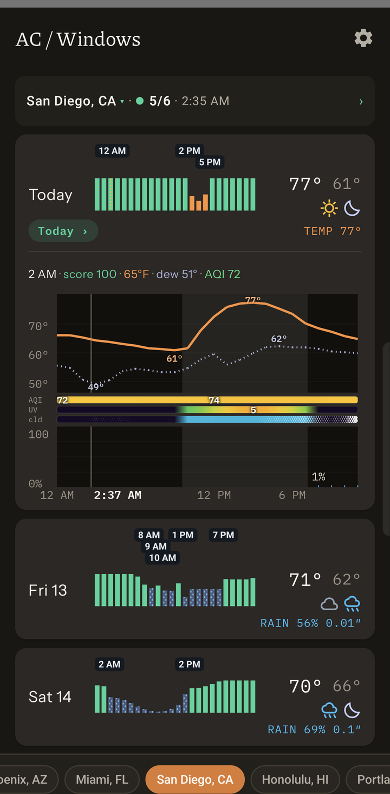
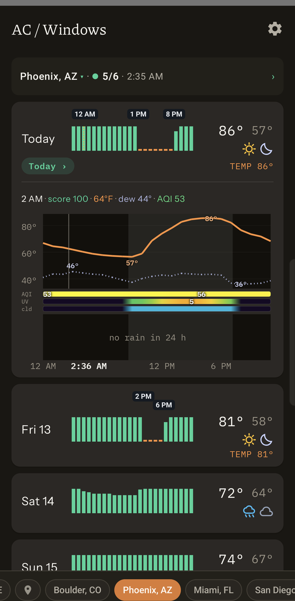
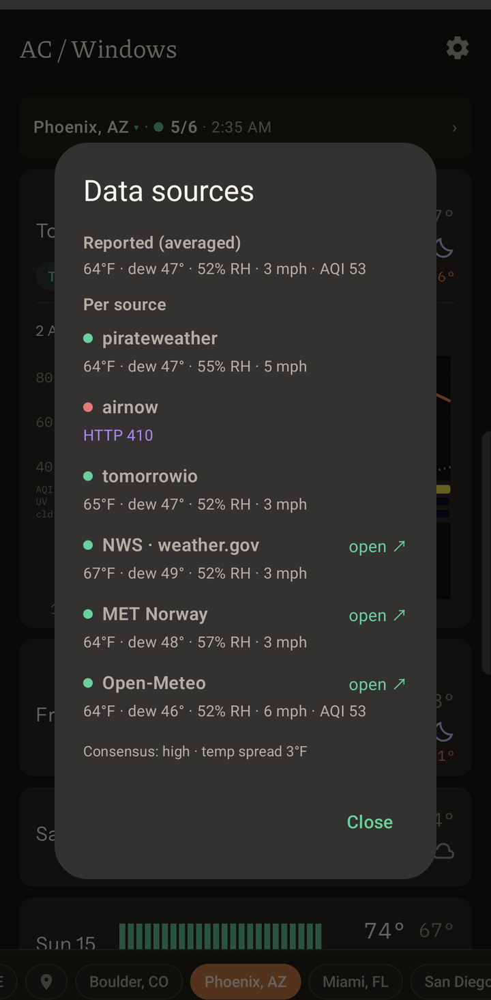
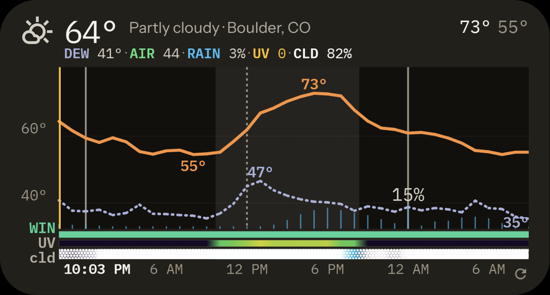

# AC / Windows

[](https://github.com/ethanez713/windows_or_ac/actions/workflows/ci.yml)

**Open the windows, or run the AC?** An Android app and home-screen widget that answers
hour by hour, so you know when outside air will cool the house for free and when to close up.

It scores every hour of the forecast on temperature, dew point, air quality and rain,
combines up to six weather sources so one bad reading cannot flip the answer, and runs
entirely on the phone: no account, no server, no telemetry.

<table>
  <tr>
    <td width="33%"></td>
    <td width="33%"></td>
    <td width="33%"></td>
  </tr>
  <tr>
    <td valign="top"><b>The week at a glance.</b> Each bar is one hour's score. Green hours are worth opening up for; the colour of the others says what ruled them out.</td>
    <td valign="top"><b>When to switch.</b> On a hot day the score falls away by mid-afternoon, and the flags mark when to close up and when to open again.</td>
    <td valign="top"><b>Sources you can check.</b> Every provider's reading is listed next to the consensus. One that fails is shown with its error and left out.</td>
  </tr>
</table>

<p></p>

**On the home screen.** The hours ahead without opening the app: temperature, dew point,
rain chance, and when the windows are worth opening. It resizes from 2×2 to full width.

## What it does

- **One number per hour.** A 0–100 Open-Window Score for every hour of the next two weeks,
  with the times to open up and close up flagged on each day.
- **Says why.** Too hot, too humid, too cold, smoky or raining: each blocked hour is
  coloured by the factor that blocked it.
- **Doesn't trust one forecast.** Open-Meteo, the US National Weather Service and MET
  Norway need no key. Tomorrow.io, Pirate Weather and EPA AirNow join when you add a key.
  The consensus is a weighted median, with a confidence drawn from how far the sources
  disagree.
- **Your comfort, not a default.** Every threshold is a setting, in °F or °C.
- **Several places.** Save locations and swipe between them.

## How the score works

```
score = 100 × temperature × humidity × air quality × rain
```

Each factor is 1 while conditions are comfortable and ramps to 0 at its cutoff. They
multiply because any one of them is a veto: a cool evening full of wildfire smoke is not
a good time to open up, however good the temperature is. Humidity is judged by dew
point, which measures the moisture in the air and does not swing with the time of day
the way relative humidity does.

This is the household version of the enthalpy economizer that commercial buildings use
for free cooling. The reasoning, the sources behind it and the models that were
considered and left out are in [docs/METHODOLOGY.md](docs/METHODOLOGY.md).

## Install

There is no store listing; build it and sideload it. JDK 17 and an Android SDK, no
Android Studio needed:

```sh
./gradlew assembleDebug
adb install -r app/build/outputs/apk/debug/app-debug.apk
```

Open the app, set a location (GPS, an address, or coordinates typed by hand), then add
the widget from the launcher. Toolchain setup, the emulator loop and troubleshooting are
in [docs/DEVELOPMENT.md](docs/DEVELOPMENT.md).

## Privacy

- The only network traffic is to the weather providers, and the only thing sent is a
  coordinate rounded to about 11 m.
- Location permission is optional. Type an address or coordinates and grant nothing.
- API keys for the optional providers stay in app-private storage and are excluded from
  cloud backup and device transfer.

## License

[GPL-3.0](LICENSE). The weather glyphs are Google's Material Symbols (Apache-2.0).
